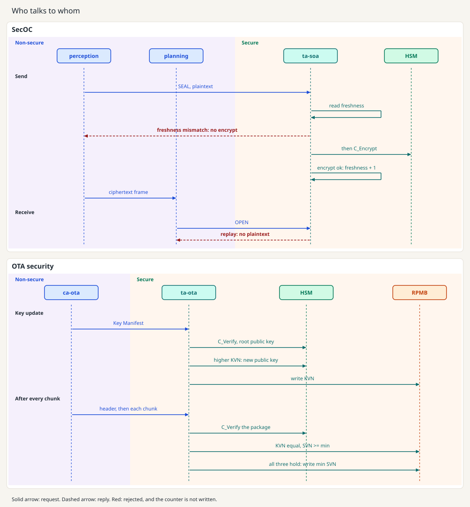
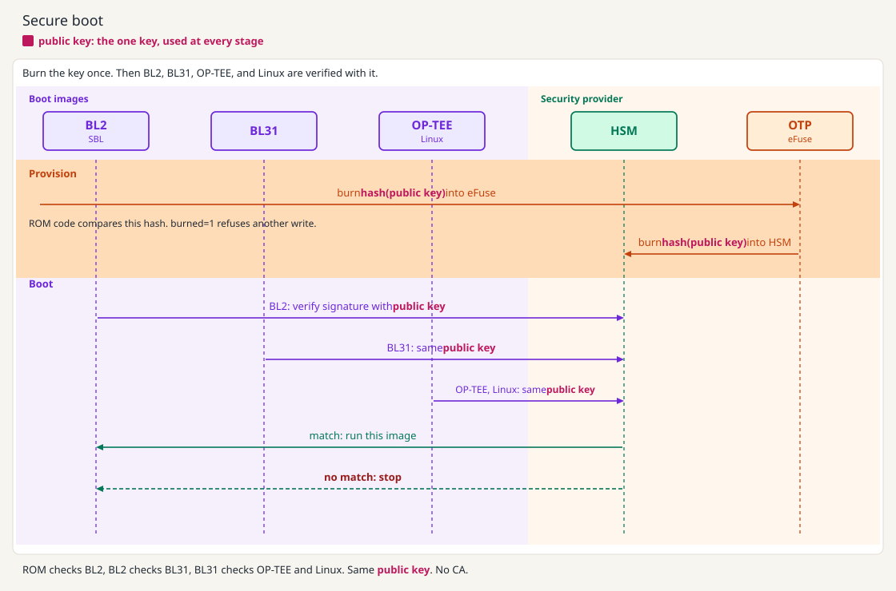
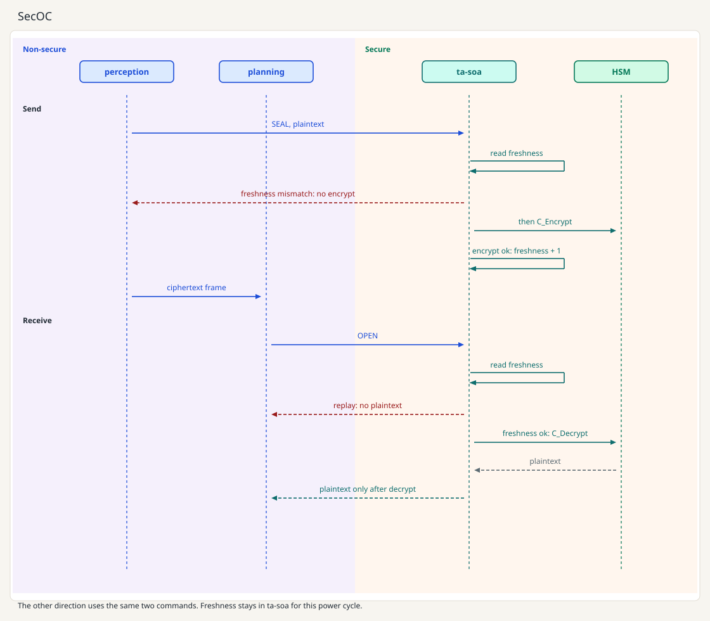
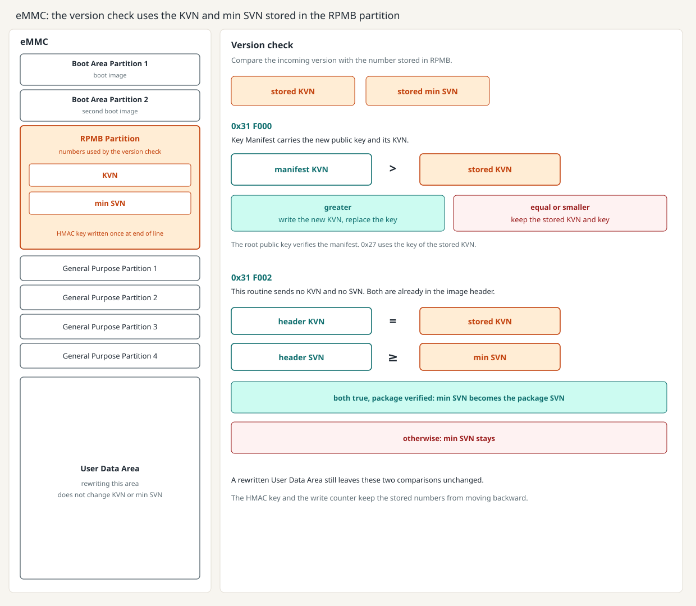
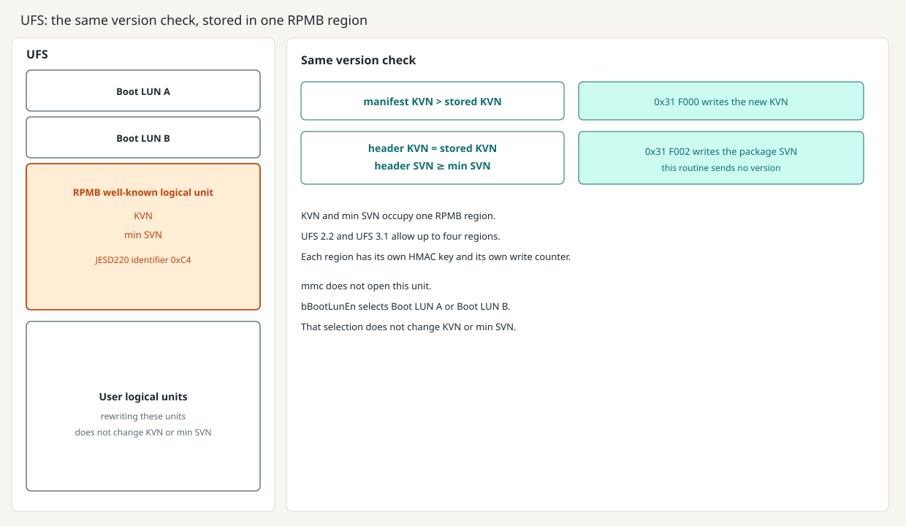
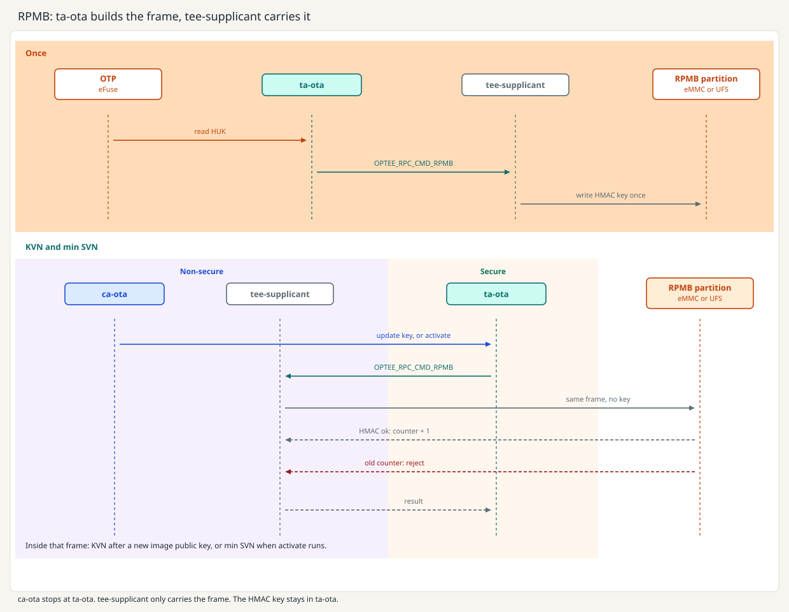
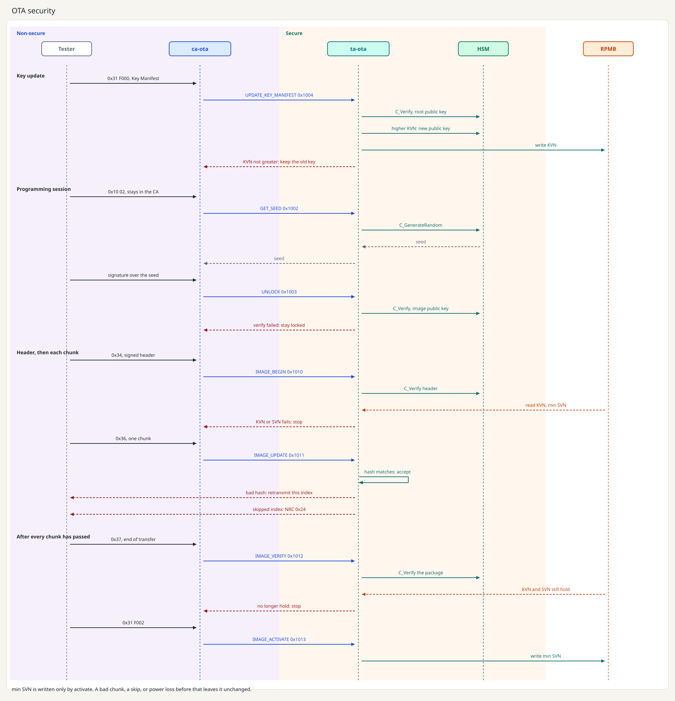

[English](README.md) | [Chinese](README_zh.md)

# AI Fortress Auto

This is a portable OP-TEE handbook for automotive information security, and a QEMU guest that runs SecOC and OTA security before a board is available. On this image the TA uses the OP-TEE crypto API. A later board changes the library path to a vendor PKCS#11 module. Those steps are in [docs/en/switch-pkcs11.md](docs/en/switch-pkcs11.md).

After reading this you should be able to say how each boot stage passes, what happens when one download chunk is bad, which checks must all hold before min SVN is written, where KVN and min SVN are kept, and which key is used for each operation.

## 1. Overview



Boot is the next section. This figure is SecOC and OTA security. The boot public key sits in OTP eFuse, and the hash of that key sits in the HSM. The application root public key is a different key: only its hash is in OTP. RPMB holds KVN and min SVN, and those two numbers only increase. SecOC freshness stays in ta-soa for this power cycle.

## 2. Secure boot sequence



There is no client application in this chain. One boot public key is burned once. The public key goes into OTP eFuse. ROM code reads that field, and after CLOSED the field cannot be written again. The hash of that public key is burned into the HSM.

The same public key then checks the image that is about to run: BL2, then BL31, then OP-TEE and Linux. A match runs that image. A mismatch stops.

While the lifecycle is open, `boot/provision_boot_key.sh --pubkey customer.pem` writes the SHA-256 of the customer's uncompressed public key into `boot/otp.state`. After `boot/lock_boot_key.sh`, the same write fails. This file is the QEMU stand-in for that hash. TF-A Trusted Board Boot on QEMU follows the same rule. This repository can already execute the open and locked checks. It has not yet baked that hash into a TF-A image that has been booted here.

## 3. SecOC



This is the in-vehicle case that SECOC covers: two directions, a freshness value, and a secret key that never sits in the client application. The algorithm is AES-128-GCM. The figure is one sequence. The purple side is non-secure: perception and planning. The warm side is secure: ta-soa and the HSM.

- `CMD_SOA_SEAL` (`0x2001`) is the send path on the figure. `CMD_SOA_OPEN` (`0x2002`) is the receive path. The reverse direction uses the same two commands.
- At boot, `ca-ota` installs the AES key into ta-soa with `CMD_SOA_INSTALL_KEY` (`0x2003`). That install is not drawn on the figure.

How to compile and open the guest is in [How to run it](#8-how-to-run-it). SecOC uses two windows. OTA uses those two, then the diagnostic tester.


## 4. RPMB, KVN, and SVN



The decision is a version check. RPMB stores the two numbers it compares: KVN and min SVN. `0x31 F000` sends a Key Manifest that already contains the new image public key and its KVN. The root public key verifies that manifest. The manifest KVN must be greater than the stored KVN before the public key is replaced and the new KVN is written. `0x31 F002` sends no version. The image header already carries KVN and SVN. Activation writes min SVN only when the package verifies, the header KVN equals the stored KVN, and the header SVN is at least min SVN. `0x27` checks the unlock signature with the public key of the stored KVN. Rewriting the User Data Area does not change either stored number. The HMAC key, written once at customer end of line, and the write counter keep those numbers from moving backward.



UFS uses the same two comparisons. KVN and min SVN sit in one RPMB region, the well-known logical unit `0xC4`. UFS 2.2 and UFS 3.1 allow up to four regions, each with its own HMAC key and its own write counter. `bBootLunEn` only selects which boot LUN runs. `mmc` does not open this unit.



RPMB, Replay Protected Memory Block, is the region drawn above. That device checks every frame. The non-secure world can carry a frame, and it cannot change the values stored in the region.

The authentication key is a separate 256-bit HMAC key. The eMMC or UFS vendor does not program it. The customer line does, once. ta-ota reads the HUK from OTP eFuse, derives this key, and writes it. That frame crosses as `OPTEE_RPC_CMD_RPMB` to `tee-supplicant`, which hands the same frame to the driver of the RPMB region. ca-ota is not on this step. The device does not read the key back out. The other copy stays in the TEE.

KVN and min SVN use the same two hops. ca-ota calls ta-ota to update the image public key or to activate, and the call stops there. ta-ota builds the frame: an address, the data, the write counter inside the device, and an HMAC-SHA256. `tee-supplicant` is a normal-world daemon, not a CA. It only carries the frame. Without the key it cannot produce an HMAC the partition accepts, so the write is rejected. A replay of an old frame is rejected too, because the write counter has already moved forward. The counter increases only after a write succeeds, and nothing outside the device can decrease it.

**KVN**, Key Version Number, is the version of the current image public key. A replacement key must be greater, so an older public key cannot return. An old Linux disk image does not decrease KVN or min SVN.

**SVN**, Security Version Number, is the security version of an image. min SVN is the lowest version that may still be activated, which blocks rolling the image back.


| Value   | When it changes                                                          | If the check fails, or power is lost before the write |
| ------- | ------------------------------------------------------------------------ | ----------------------------------------------------- |
| KVN     | The root public key accepts a new image public key with a higher version | Keep the old public key and the old KVN               |
| min SVN | The whole package verifies and activation writes the package SVN         | Keep the old minimum security version                 |


**When the device has this partition**

The TEE writes the authentication key at customer end of line. If the normal world programs it first, the TEE cannot use the partition afterwards. On an eMMC board the rootfs can include the `mmc` command from mmc-utils (`BR2_PACKAGE_MMC_UTILS=y`). That command sends MMC ioctls from Linux. It can read the write counter, and it can program the HMAC key. tee-supplicant does not link it. ta-ota still passes the frame as `OPTEE_RPC_CMD_RPMB` to the kernel driver. UFS RPMB is not reached with `mmc`. If the device does not accept a later write of KVN or min SVN, those two values stay unchanged, and they are not copied into a normal file.

**When the device has no RPMB**

`/data/tee` is present only when OP-TEE is built with `CFG_REE_FS=y`. That option selects the REE filesystem backend, and `tee-supplicant` then stores the objects in this directory. `CFG_REE_FS=n` leaves no `/data/tee`. The files are encrypted with a key from the HUK, and a changed file is detected. Replacing the whole directory with an older copy still verifies, so this store does not block rollback. KVN and min SVN then use another anchor that only increases: a monotonic counter in the SoC, or an NV counter in the HSM. min SVN can also be burned into OTP fuse bits. Those bits are few, and they only record the floor. When no such anchor is available, the two values are not treated as written.

This QEMU virt machine has no eMMC and no UFS device, so `mmc` has nothing to open. The image still selects mmc-utils for a later eMMC board. KVN and min SVN on this image stay in the REE filesystem. Each boot starts again at KVN 1 and min SVN 1. The guest does not check a device write counter.

## 5. OTA security: chunk checks, then the decision after download



The figure is the sequence: key update, the programming session, the header and each chunk, then activation. The demo does not install the bytes into the running system. The receiver is a buffer.

Activation writes min SVN only when the package verifies, the header KVN equals the stored KVN, and the header SVN is at least min SVN.

The header is signed by the current image private key. It carries the total length, SVN, KVN, the package hash, and the SHA-256 of every chunk. `CMD_IMAGE_UPDATE` (`0x1011`) copies a chunk out of shared memory into the secure world and hashes that copy.

- The hash matches the header entry for that index, and the index is the previous index plus one: accept the chunk.
- The hash does not match: reject only that chunk. The tester retransmits the same index.
- The index skips ahead: reject it. This is UDS NRC `0x24`. Sending the same index again is a retransmission. The UDS `blockSequenceCounter` is one byte. It starts at `0x01`, and after `0xFF` it wraps to `0x00`.
- Power loss in the middle: resume from the last accepted index. min SVN stays unchanged until activation.

`0x22` is `CMD_GET_STATUS` (`0x1001`) and returns version numbers only.

`make -C protocol test` covers these decisions on the host: an old KVN, a bad chunk, a skipped index, retransmission, a lower SVN, power loss before activation (min SVN unchanged), and the UDS counter wrap.

## 6. How each key is used

Secret-key plaintext stays inside the HSM. The secure world keeps the handle. A public key can be read back.


| Key                | Where it lives                                                                                          | What it is used for                                                          |
| ------------------ | ------------------------------------------------------------------------------------------------------- | ---------------------------------------------------------------------------- |
| Boot public key    | The key is in OTP eFuse. Its hash is in the HSM.                                                        | Checks BL2, then BL31, then OP-TEE and Linux.                                |
| HUK                | Another field in the same OTP eFuse.                                                                    | Derives the RPMB HMAC key, and the `/data/tee` key when `CFG_REE_FS=y`.     |
| RPMB HMAC key      | Derived in the TEE from the HUK and written once at customer end of line. The eMMC or UFS vendor does not ship it. | Authenticates each frame of the RPMB region.                                 |
| Root public key    | The private key stays offline. The hash is a different OTP field from the boot public key.             | Verifies a Key Manifest.                                                     |
| Image public key   | In the HSM. The version is KVN, stored in RPMB or on another monotonic anchor.                         | Verifies the image header, each chunk, and the unlock signature.            |
| SecOC AES key      | An HSM handle. AES-128-GCM.                                                                             | Encrypts a frame after the freshness check. Freshness stays in ta-soa.      |


Switching to a real device changes the library path. The steps are in [docs/en/switch-pkcs11.md](docs/en/switch-pkcs11.md). How the HSM and the TEE split the work is in [docs/en/hsm.md](docs/en/hsm.md).

## 7. Who may open a TA

A CA enters a TA with `TEEC_OpenSession` and `TEEC_LOGIN_GROUP`. The kernel builds the client identity from a Linux group. `libteeacl.so` (`WITH_TEEACL=1`) checks membership and computes the same identity. The build writes it to `dep-src/out/aarch64/optee_client` and `dep-src/out/aarch32/optee_client`. The guest CA links `-lteeacl`.

`fortress-ota` is the group for ca-ota. It is the group that may open ta-ota, and the group that may install the SecOC key into ta-soa. `fortress-perception` and `fortress-planning` are the groups that may seal and open frames on ta-soa. A process outside the group gets no session, so it cannot activate an image or emit a SecOC frame. The calls, and the check the TA does on `gpd.client.identity`, are in [docs/en/session-login.md](docs/en/session-login.md).

## 8. How to run it

The usual target is aarch64. Run one QEMU at a time. Leave the Linux window with Ctrl-a x. Leave the OP-TEE window with Ctrl-]. Sources live outside the git tree in `dep-src/`.

### Compile

```bash
scripts/prepare_sources.sh
scripts/aarch64/prepare_env.sh
scripts/aarch64/build_qemu.sh
```

`prepare_sources.sh` clones the trees pinned in `versions.env`. `prepare_env.sh` checks for `bison`, `flex`, and `dtc`. A missing package makes it print the install command and exit. `build_qemu.sh` does not install packages and does not compile QEMU itself. It builds TF-A, U-Boot, OP-TEE, Linux, and Buildroot, then `install_guest.sh` packs ta-ota, ta-soa, perception, planning, and ca-ota into the rootfs. The boot files are in `dep-src/out/aarch64`. If `bl1.bin`, `Image`, or `rootfs.cpio.gz` is missing, `run_SecOC.sh` and `run_OTA.sh` print the missing names and exit.

`scripts/aarch64/build.sh` builds OP-TEE OS, optee_client, and the host tests. It does not build the bootable image.

The 32-bit image uses separate Linux, U-Boot, OP-TEE, and TF-A outputs, so it does not replace the aarch64 image:

```bash
scripts/prepare_sources.sh
scripts/aarch32/prepare_env.sh
scripts/aarch32/build_qemu.sh
```

That writes `dep-src/out/aarch32`. It needs `qemu-system-arm`. When `dep-src/` already matches `versions.env`, `prepare_sources.sh` does not download again.

### Run SecOC

Two terminals. SecOC does not use the diagnostic tester.

```bash
scripts/aarch64/run_SecOC.sh
scripts/aarch64/run_tee.sh
```

After Linux boots, ca-ota installs the AES key into ta-soa. perception and planning then exchange a new plaintext every 100 ms.

The 32-bit pair is `scripts/aarch32/run_SecOC.sh` and `scripts/aarch32/run_tee.sh`.

### Run OTA

Stop the SecOC QEMU first. Two terminals, then the tester:

```bash
scripts/aarch64/run_OTA.sh
scripts/aarch64/run_tee.sh
scripts/diag_tester.sh
```

ca-ota waits. The tester unlocks with `0x27`, then sends the manifest, the ordered chunks, verify, and activate. The 32-bit Linux window is `scripts/aarch32/run_OTA.sh` with `scripts/aarch32/run_tee.sh`. The tester command is `scripts/diag_tester.sh aarch32`.

To move onto your own board, follow [docs/en/porting.md](docs/en/porting.md) and copy `scripts/aarch64/platform.env`. Change `CROSS_COMPILE` and `OPTEE_PLATFORM`. Do not copy the CAs, TAs, or `protocol/`.

## 9. Appendix

- Command numbers and UDS: [docs/en/ca-ta-api.md](docs/en/ca-ta-api.md), [docs/en/uds-map.md](docs/en/uds-map.md)
- Porting: [docs/en/porting.md](docs/en/porting.md)
- Switching the PKCS#11 library: [docs/en/switch-pkcs11.md](docs/en/switch-pkcs11.md)
- QEMU image, first stage: [docs/en/build-qemu.md](docs/en/build-qemu.md)
- Who may open a TA: [docs/en/session-login.md](docs/en/session-login.md)

