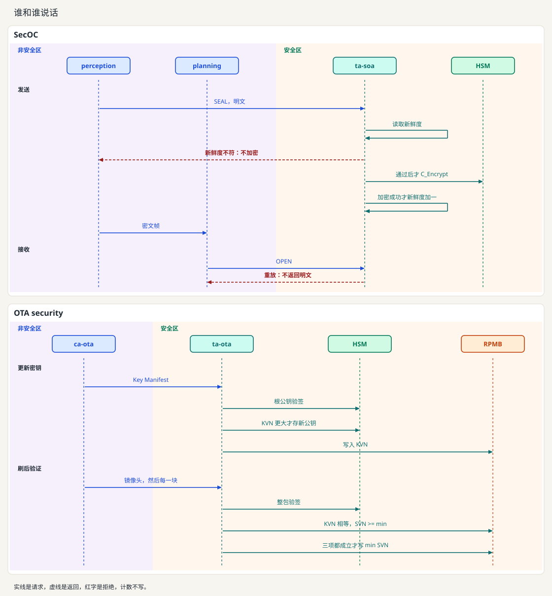
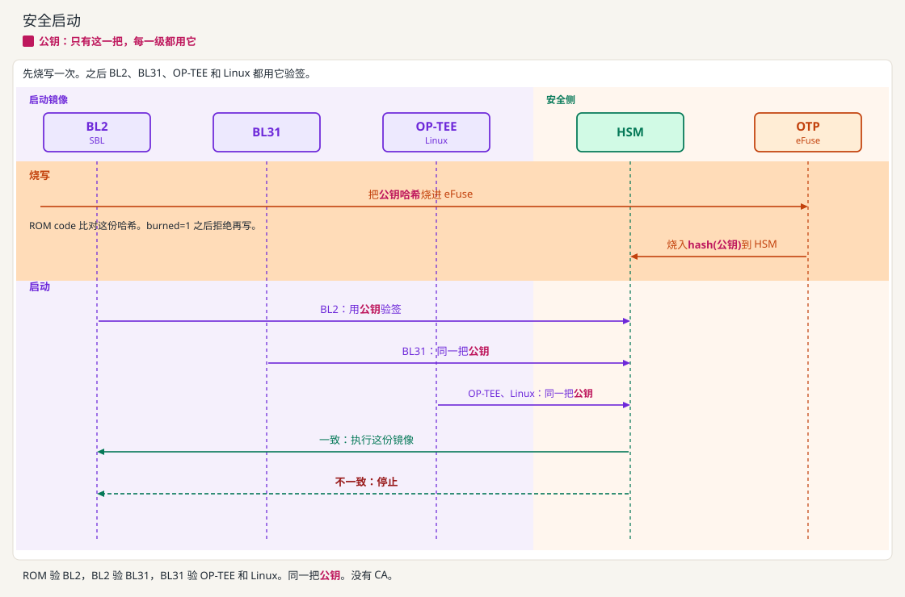
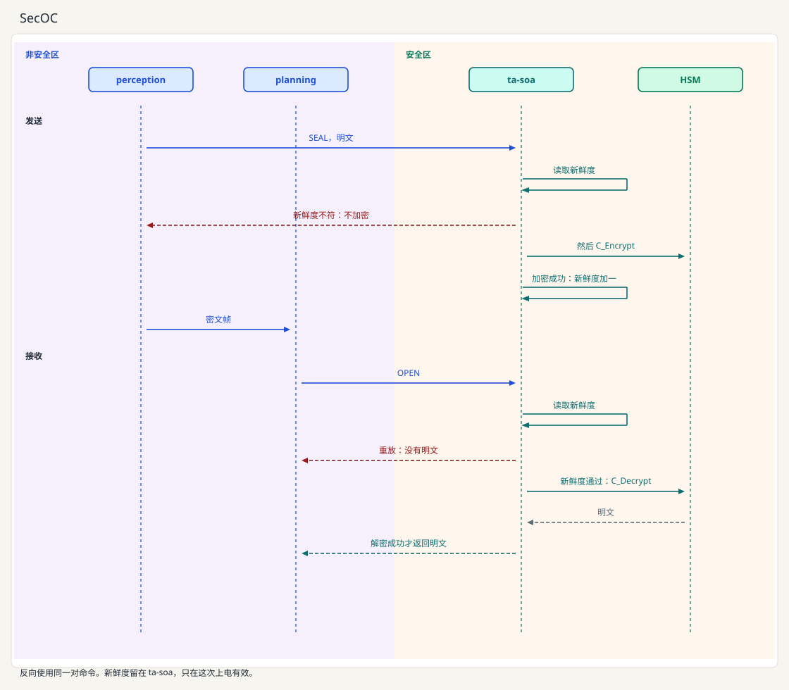
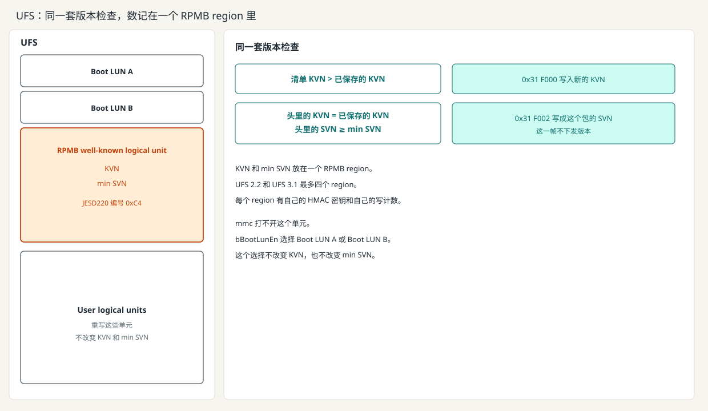
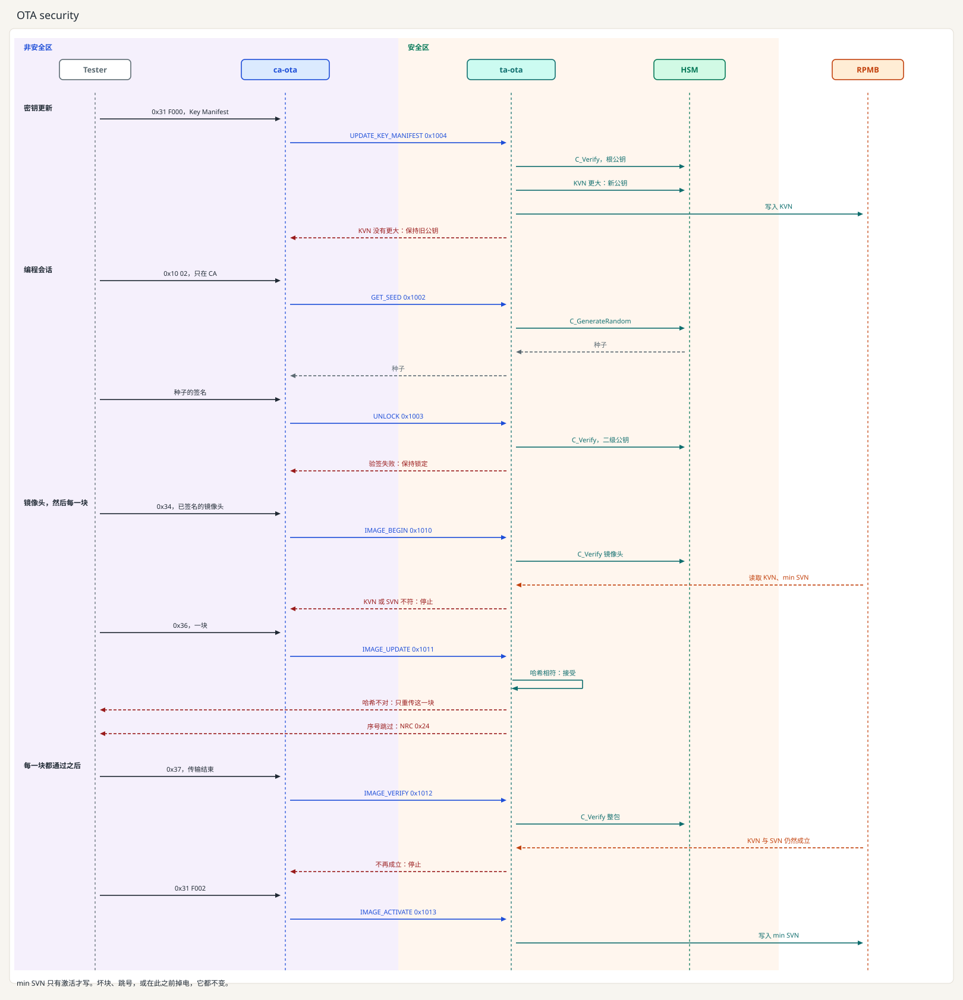

[English](README.md) | 中文

# AI Fortress Auto

这是一份可移植的 OP-TEE 车载信息安全手册，也是一块在有板子之前就能跑 SecOC 和 OTA security 的 QEMU 客户机。这张镜像里 TA 使用 OP-TEE 的密码接口。以后换到板子上，再把库路径改到厂商的 PKCS#11 模块。步骤在 [docs/zh/switch-pkcs11.md](docs/zh/switch-pkcs11.md)。

读完应能说出：启动每一级怎样才算通过、下载时一块坏了会怎样、刷写完成后哪几项同时成立才写 min SVN、KVN 和 min SVN 记在哪里、每把密钥用在哪一次运算上。

## 1. 全貌



启动在下一节。这里是 SecOC 和 OTA security。启动公钥在 OTP eFuse 里，这把公钥的哈希在 HSM 里。应用根公钥是另一把钥匙，OTP 里只放它的哈希。RPMB 里是 KVN 和 min SVN，这两个数只增不减。SecOC 的新鲜度留在 ta-soa，只在这次上电有效。

## 2. 安全启动流程



这一段没有 CA。启动公钥只烧一次。公钥写入 OTP eFuse。ROM code 读的是这一段，CLOSED 之后这一段不能再写。这把公钥的哈希烧进 HSM。

随后用同一把公钥核对即将运行的镜像：先是 BL2，然后 BL31，然后 OP-TEE 和 Linux。对上就运行这一级。对不上就停。

生命周期为开时，`boot/provision_boot_key.sh --pubkey customer.pem` 把客户公钥未压缩点的 SHA-256 写入 `boot/otp.state`。`boot/lock_boot_key.sh` 之后，同一条写入会失败。这个文件是 QEMU 上对这个哈希的替身。QEMU 上的 TF-A Trusted Board Boot 使用同一规则。当前仓库已经把开锁和锁定做成可执行检查，还没有把该哈希烧进一次启动过的 TF-A 镜像。

## 3. SecOC



这是 SECOC 那一类车内安全通信：双向、带新鲜度、秘密密钥不在 CA 里。算法是 AES-128-GCM。图是一条序列。浅紫是非安全区：perception 和 planning。浅暖色是安全区：ta-soa 和 HSM。

- `CMD_SOA_SEAL`（`0x2001`）是图上的发送路径。`CMD_SOA_OPEN`（`0x2002`）是接收路径。反向使用同一对命令。
- 开机时 `ca-ota` 用 `CMD_SOA_INSTALL_KEY`（`0x2003`）把 AES 密钥装进 ta-soa。这一步没有画在图上。

编译和打开客户机见 [操作](#8-操作)。SecOC 是两个窗口。OTA 是这两个窗口，然后再开诊断仪。

## 4. RPMB、KVN、SVN


判决是一次版本检查。RPMB 里放用来比较的两个数：KVN 和 min SVN。`0x31 F000` 送出的 Key Manifest 里已经有新的二级公钥和它的 KVN。根公钥验这份清单。清单里的 KVN 大于已保存的 KVN，才替换公钥并写入新的 KVN。`0x31 F002` 不下发版本。镜像头里已经有 KVN 和 SVN。整包验过、头里的 KVN 等于已保存的 KVN、头里的 SVN 不低于 min SVN，激活才把 min SVN 写成这个包的 SVN。`0x27` 用已保存 KVN 对应的公钥验解锁签名。重写 User Data Area 不改变这两个数。客户下线写入一次的 HMAC 密钥和写计数，用来保住这两个数，不让它们退回去。



UFS 用同样的两次比较。KVN 和 min SVN 放在一个 RPMB region，也就是编号 `0xC4` 的 well-known logical unit。UFS 2.2 和 UFS 3.1 最多四个 region，各自有自己的 HMAC 密钥和写计数。`bBootLunEn` 只选择从哪一个 Boot LUN 启动。`mmc` 打不开这个单元。


RPMB，Replay Protected Memory Block，就是上面画的那一块。验帧的是这颗闪存。非安全区可以把帧送过去，改不了里面的值。

认证密钥是单独的一把 256 位 HMAC 密钥。颗粒厂不写这把密钥。客户下线写一次。ta-ota 从 OTP eFuse 读出 HUK，推出这把密钥，并写入。这一帧以 `OPTEE_RPC_CMD_RPMB` 交给 `tee-supplicant`，再由它把同一帧交给 RPMB 的驱动。这一步没有 ca-ota。设备不把这把密钥读出来，另一份只留在 TEE 里。

KVN 和 min SVN 走同样的两跳。ca-ota 调用 ta-ota 更新二级公钥或执行激活，调用停在 ta-ota。ta-ota 组帧：地址、数据、设备内部的写计数，以及 HMAC-SHA256。`tee-supplicant` 是普通世界里的守护进程，不是 CA，只搬运这一帧。没有密钥就产不出分区会接受的 HMAC，写入被拒绝。旧帧再送也会被拒绝，因为写计数已经往前走过。计数只在写入成功后加一，设备外面减不回去。

**KVN**，Key Version Number，是当前二级公钥的版本。换上的公钥必须更大，旧公钥不能再回来。整盘换回旧的 Linux 文件，改不小 KVN 和 min SVN。

**SVN**，Security Version Number，是镜像自己的安全版本。min SVN 是还允许激活的最低版本，用来挡住镜像回滚。

| 值 | 何时改变 | 失败或掉电在写入之前 |
| --- | --- | --- |
| KVN | 根公钥验过新的二级公钥，且版本更大 | 保持旧公钥和旧 KVN |
| min SVN | 整包验签通过，激活时写成这个包的 SVN | 保持旧的最低安全版本 |

**设备上有这块分区**

认证密钥由 TEE 在客户下线写入。普通世界如果抢先写入，TEE 以后就用不了这块分区。eMMC 板上，rootfs 可以带上 mmc-utils 的 `mmc` 命令（`BR2_PACKAGE_MMC_UTILS=y`）。它从 Linux 发 MMC ioctl，可以读写计数，也可以写入这把 HMAC 密钥。tee-supplicant 不链接它。ta-ota 仍把帧以 `OPTEE_RPC_CMD_RPMB` 交给内核驱动。UFS 的 RPMB 不走 `mmc`。之后写入 KVN 或 min SVN 时，设备不接受，这两个数就保持原值，也不改存到普通文件。

**设备上没有 RPMB**

`/data/tee` 只有在 OP-TEE 编译时打开 `CFG_REE_FS=y` 才有。这个选项选用 REE 文件系统后端，`tee-supplicant` 才把对象存进这个目录。`CFG_REE_FS=n` 时没有 `/data/tee`。文件用 HUK 推出的密钥加密，文件被改能发现。把整个目录换回旧副本，校验仍然通过，挡不住回滚。KVN 和 min SVN 要改接到另一个只增不减的锚：SoC 的单调计数器，或 HSM 里的 NV 计数器。min SVN 也可以烧在 OTP 熔丝位上。这些位很少，只用来记下限。没有任何可用的锚时，不把这两个数当成已经写下。

这张 QEMU virt 机器没有 eMMC，也没有 UFS，所以 `mmc` 没有设备可开。镜像仍为以后的 eMMC 板子选上 mmc-utils。这张镜像上的 KVN 和 min SVN 在 REE 文件系统。每次启动回到 KVN 1 和 min SVN 1。客户机不检查设备里的写计数。

## 5. OTA security：分块校验，以及刷完之后的判决



图上的顺序是：密钥更新、编程会话、镜像头和每一块，然后激活。演示不把数据装进正在运行的系统。接收端是一块缓冲区。

激活写入 min SVN，要整包验签通过、头里的 KVN 等于已保存的 KVN、头里的 SVN 不低于 min SVN。

镜像头由当前镜像私钥签名。头里有总长度、SVN、KVN、整包哈希，以及每一块的 SHA-256。`CMD_IMAGE_UPDATE`（`0x1011`）先把一块从共享内存拷进安全世界，再算这块的哈希。

- 哈希与头中该序号一致，且序号正好是上一块加一：接受。
- 哈希不对：只拒绝这一块。Tester 重传同一序号。
- 序号跳变：拒绝，对应 UDS NRC `0x24`。同一序号再来一次视为重传。UDS 的 `blockSequenceCounter` 是单字节，从 `0x01` 递增，`0xFF` 之后绕回 `0x00`。
- 中途掉电：从最后一块已通过的序号继续。min SVN 要等到激活才变。

`0x22` 是 `CMD_GET_STATUS`（`0x1001`），只返回版本号。

这些判决的主机测试在 `make -C protocol test` 里，覆盖旧 KVN、坏块、跳号、重传、更小的 SVN、激活前后掉电（激活前 min SVN 不变），以及 UDS 计数器绕回。

## 6. 密钥怎么被用

对称密钥的明文留在 HSM 里。安全世界保存句柄。公钥可以读出来核对。

| 密钥 | 放在哪里 | 用来做什么 |
| --- | --- | --- |
| 启动公钥 | 公钥在 OTP eFuse。它的哈希在 HSM。 | 核对 BL2，然后 BL31，然后 OP-TEE 和 Linux。 |
| HUK | 同一块 OTP eFuse 里的另一段。 | 推出 RPMB 的 HMAC 密钥；`CFG_REE_FS=y` 时也推出 `/data/tee` 的密钥。 |
| RPMB HMAC 密钥 | 在 TEE 里由 HUK 推出，客户下线写入一次。颗粒厂不带这把密钥。 | 给 RPMB 的每一帧做认证。 |
| 根公钥 | 私钥留在线外。哈希在 OTP 的另一段，和启动公钥不是同一段。 | 验 Key Manifest。 |
| 二级公钥 | 在 HSM 里。版本号是 KVN，记在 RPMB 或另一个只增不减的锚上。 | 验镜像头、每一块，以及解锁时的签名。 |
| SecOC AES 密钥 | HSM 里的句柄。AES-128-GCM。 | 新鲜度通过之后加密一帧。新鲜度本身留在 ta-soa。 |

换到真设备时改的是库路径，步骤在 [docs/zh/switch-pkcs11.md](docs/zh/switch-pkcs11.md)。HSM 和 TEE 怎么分工见 [docs/zh/hsm.md](docs/zh/hsm.md)。

## 7. 谁可以打开 TA

CA 用 `TEEC_OpenSession` 和 `TEEC_LOGIN_GROUP` 进入 TA。内核用 Linux 组号生成客户端身份。`libteeacl.so`（`WITH_TEEACL=1`）检查进程是否在组内，并算出同一个身份。编译结果在 `dep-src/out/aarch64/optee_client` 和 `dep-src/out/aarch32/optee_client`。客户机上的 CA 链接 `-lteeacl`。

`fortress-ota` 是 ca-ota 的组。这个组可以打开 ta-ota，也可以把 SecOC 密钥装进 ta-soa。`fortress-perception` 和 `fortress-planning` 是可以在 ta-soa 上封包和拆包的组。不在组里的进程没有会话，也就不能激活镜像或发出一帧 SecOC。调用步骤，以及 TA 对 `gpd.client.identity` 的核对，见 [docs/zh/session-login.md](docs/zh/session-login.md)。

## 8. 操作

常用的是 aarch64。一次只跑一个 QEMU。Linux 窗口用 Ctrl-a x 退出。OP-TEE 窗口用 Ctrl-] 退出。源码在仓库外的 `dep-src/`，不进 git。

### 编译

```bash
scripts/prepare_sources.sh
scripts/aarch64/prepare_env.sh
scripts/aarch64/build_qemu.sh
```

`prepare_sources.sh` 按 `versions.env` 克隆源码。`prepare_env.sh` 检查 `bison`、`flex` 和 `dtc`。缺包时打印安装命令并退出。`build_qemu.sh` 不装包，也不编译 QEMU 本体。它编译 TF-A、U-Boot、OP-TEE、Linux 和 Buildroot，然后由 `install_guest.sh` 把 ta-ota、ta-soa、perception、planning 和 ca-ota 打进 rootfs。启动文件在 `dep-src/out/aarch64`。缺 `bl1.bin`、`Image` 或 `rootfs.cpio.gz` 时，`run_SecOC.sh` 和 `run_OTA.sh` 会打印缺什么并退出。

`scripts/aarch64/build.sh` 只编 OP-TEE OS、optee_client 和主机测试，不编可启动的镜像。

32 位镜像使用单独的 Linux、U-Boot、OP-TEE 和 TF-A 输出，不会换掉 aarch64 镜像：

```bash
scripts/prepare_sources.sh
scripts/aarch32/prepare_env.sh
scripts/aarch32/build_qemu.sh
```

产物在 `dep-src/out/aarch32`。需要 `qemu-system-arm`。`dep-src/` 已经和 `versions.env` 一致时，`prepare_sources.sh` 不会再下载。

### 运行 SecOC

两个终端。SecOC 不用诊断仪。

```bash
scripts/aarch64/run_SecOC.sh
scripts/aarch64/run_tee.sh
```

Linux 起来后，ca-ota 把 AES 密钥装进 ta-soa。随后 perception 和 planning 每 100 ms 交换一帧新明文。

32 位是 `scripts/aarch32/run_SecOC.sh` 和 `scripts/aarch32/run_tee.sh`。

### 运行 OTA

先停掉 SecOC 的 QEMU。两个终端，然后再开诊断仪：

```bash
scripts/aarch64/run_OTA.sh
scripts/aarch64/run_tee.sh
scripts/diag_tester.sh
```

ca-ota 会等待。诊断仪先做 `0x27` 解锁，再送清单、顺序分包、验签，然后激活。32 位 Linux 窗口是 `scripts/aarch32/run_OTA.sh`，配 `scripts/aarch32/run_tee.sh`。诊断仪命令是 `scripts/diag_tester.sh aarch32`。

换到自己的板子：按 [docs/zh/porting.md](docs/zh/porting.md)，复制 `scripts/aarch64/platform.env`，改 `CROSS_COMPILE` 和 `OPTEE_PLATFORM`。CA、TA 和 `protocol/` 不复制。

## 9. 附录

- 命令号和 UDS：[docs/zh/ca-ta-api.md](docs/zh/ca-ta-api.md)、[docs/zh/uds-map.md](docs/zh/uds-map.md)
- 移植：[docs/zh/porting.md](docs/zh/porting.md)
- 换 PKCS#11 库：[docs/zh/switch-pkcs11.md](docs/zh/switch-pkcs11.md)
- QEMU 镜像第一阶段：[docs/zh/build-qemu.md](docs/zh/build-qemu.md)
- 谁可以打开 TA：[docs/zh/session-login.md](docs/zh/session-login.md)
