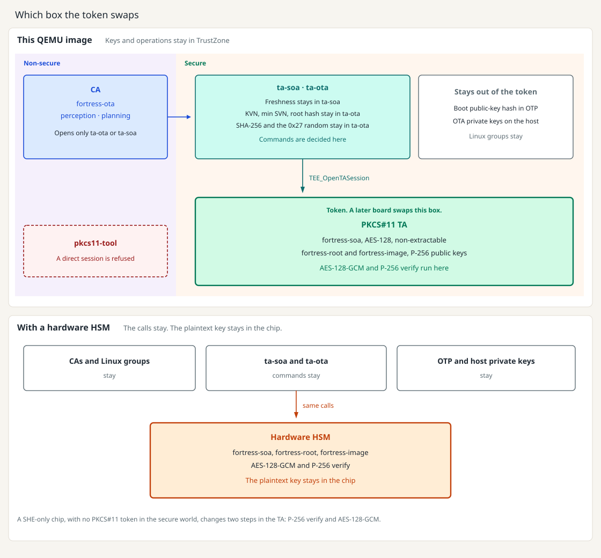

[English](hsm.md) | [Chinese](../zh/hsm.md)

# HSM

An HSM is a module with key slots, a crypto engine, and access control. It may be a separate chip or a security subsystem inside the SoC. A secret key is imported inside the module and marked non-extractable. Callers receive a handle. Encrypt and verify run inside the module, and the plaintext key is not returned.

PKCS#11 is the interface used to reach a token: slots, sessions, objects, and mechanisms. PKCS#11 itself is not an HSM. SoftHSM is a software token that runs in the normal world. This tree does not use it.

The TEE, here OP-TEE, is the secure-world environment. TrustZone is already a security boundary. The CPU can also run AES and SHA instructions, so the TEE is not a software-only fallback. A discrete HSM adds its own engine and a key vault: a defect in a TA cannot read a key that never enters TA memory. That isolation is the reason to add one. SecOC frames and OTA signatures are small, so the change is not for speed.

Linux groups are a separate gate, and they do not move when a token is added. `fortress-ota` may open ta-ota and may install the SecOC key. `fortress-perception` and `fortress-planning` may seal and open frames on ta-soa. A CA still talks only to those two TAs.

A hardware HSM replaces the outlined box. The CAs, the Linux groups, and the commands on ta-ota and ta-soa stay. KVN, min SVN, the root public-key hash, chunk SHA-256, the `0x27` random number, and SecOC freshness stay in the business TAs. The boot public-key hash stays in OTP. OTA private keys stay on the host.

On this image that box is the OP-TEE PKCS#11 TA, so the keys and the operations stay inside TrustZone. On a board the same calls send the AES key and verify into the HSM, and the plaintext key stays in the chip.

A chip that only has SHE slots, and no PKCS#11 token in the secure world, changes two steps inside the business TA: P-256 verify and AES-128-GCM. What the figure leaves in the business TAs, in OTP, and on the host stays there.

## This QEMU image

This image has no HSM chip. The stand-in is the OP-TEE PKCS#11 TA, UUID `fd02c9da-306c-48c7-a49c-bbd827ae86ee`. The build sets `CFG_PKCS11_TA=y`. AES-128-GCM and P-256 verify run in that TA. The 16-byte SecOC key is not kept in ta-soa. A later board replaces this token with the hardware HSM. The business TAs keep the same calls. `config/hsm.env` is not read.

ta-ota and ta-soa open the token with `TEE_OpenTASession` and the command layout in `pkcs11_ta.h`. `libckteec.so` is the normal-world library used by `pkcs11-tool`. A TA does not load it.

The token's open-session entry accepts only ta-ota (`8f7a1c2e-6b4d-4e91-9c3a-2d5e7f10a001`) and ta-soa (`8f7a1c2e-6b4d-4e91-9c3a-2d5e7f10a002`). A normal-world `pkcs11-tool` session is refused. The PIN is not the boundary.

Three token objects, looked up by label. Replacing one destroys it and creates it again:

| Label | Object | Use |
| --- | --- | --- |
| `fortress-soa` | AES-128, sensitive, non-extractable | Seal and open one SecOC frame |
| `fortress-root` | P-256 public key | Verify a Key Manifest |
| `fortress-image` | P-256 public key | Verify the image header and the 0x27 unlock signature |

ta-ota still stores the public-key bytes, KVN, min SVN, and the root public-key hash in `fortress.ota`. The hash check needs those bytes. Verify uses the token object. SHA-256 of a chunk and the 0x27 random number stay in ta-ota. Freshness stays in ta-soa and is checked before AES-GCM. AES-GCM uses a 12-byte IV, 10 bytes of additional data, and a 16-byte tag. P-256 verify sends the SHA-256 digest and uses `CKM_ECDSA`, so the token does not hash the message again.

KVN, min SVN, the chunk index, and SecOC freshness are not keys. This tree does not use RPMB. The boot public-key hash stays in OTP and is checked by the boot chain, not by this token. OTA private keys stay on the host.

If the PKCS#11 TA is missing, the command fails. There is no fall back to `TEE_ALG_*`. The wiring is in [switch-pkcs11.md](switch-pkcs11.md).
