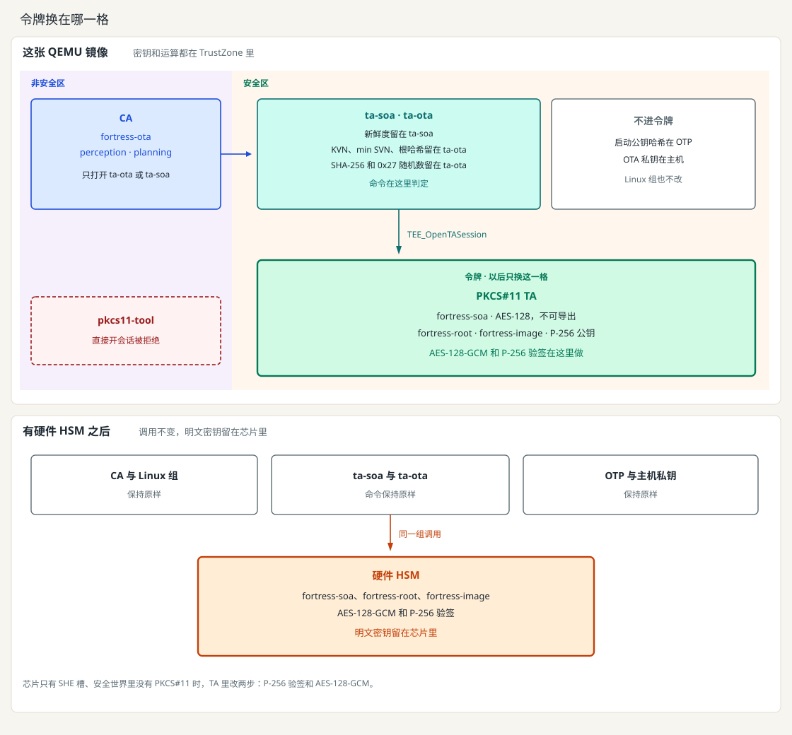

[English](../en/hsm.md) | 中文

# HSM

HSM 是带密钥槽、密码引擎和访问控制的模块，可以是独立芯片，也可以是 SoC 里的安全子系统。秘密密钥在模块内导入，并标成不可导出。调用方拿到句柄。加密和验签在模块内完成，明文不返回。

PKCS#11 是访问令牌的接口：槽、会话、对象、机制。它本身不是 HSM。SoftHSM 是跑在普通世界里的软件令牌。本仓库不用它。

TEE（这里是 OP-TEE）是安全世界里的环境。TrustZone 本身就是安全边界。这颗 CPU 也能执行 AES 和 SHA 指令，所以 TEE 不是纯软件退路。独立 HSM 多出来的是自己的引擎和钥匙库：密钥不进 TA 内存时，TA 里的缺陷碰不到明文。接 HSM 是为了这层隔离。SecOC 一帧和 OTA 一次验签都很小，不是为了算得更快。

哪个 Linux 组能开会话，和有没有令牌无关，加了令牌也不改。`fortress-ota` 可以打开 ta-ota，也可以装入 SecOC 密钥。`fortress-perception` 和 `fortress-planning` 可以对 ta-soa 做封装和打开。CA 仍然只和这两个 TA 说话。

换成硬件 HSM 时，动的是图里描边的那一格。CA、Linux 组、ta-ota 和 ta-soa 的命令不变。KVN、min SVN、根公钥哈希、分块 SHA-256、`0x27` 随机数和 SecOC 新鲜度仍留在业务 TA。启动公钥哈希仍在 OTP。OTA 私钥仍在主机。

这张镜像上，那一格是 OP-TEE 的 PKCS#11 TA，密钥和运算都在 TrustZone 里。板上换成硬件 HSM 后，同一组调用把 AES 密钥和验签送进 HSM，明文密钥留在芯片里。

芯片只有 SHE 槽、安全世界里没有 PKCS#11 令牌时，业务 TA 里改两步：P-256 验签和 AES-128-GCM。图上留在业务 TA、OTP 和主机上的那些，位置不变。

## 这张 QEMU 镜像

这张镜像没有 HSM 芯片。代替它的是 OP-TEE 的 PKCS#11 TA，UUID 是 `fd02c9da-306c-48c7-a49c-bbd827ae86ee`。编译打开 `CFG_PKCS11_TA=y`。AES-128-GCM 和 P-256 验签在这个 TA 里执行。SecOC 的 16 字节密钥不留在 ta-soa。以后换到板子上，用硬件 HSM 替换这个令牌。业务 TA 的调用不变。`config/hsm.env` 没有被读取。

ta-ota 和 ta-soa 用 `TEE_OpenTASession` 调用它，命令格式在 `pkcs11_ta.h`。`libckteec.so` 是 `pkcs11-tool` 使用的普通世界库。TA 不加载它。

令牌的打开会话只接受 ta-ota（`8f7a1c2e-6b4d-4e91-9c3a-2d5e7f10a001`）和 ta-soa（`8f7a1c2e-6b4d-4e91-9c3a-2d5e7f10a002`）。普通世界的 `pkcs11-tool` 会话会被拒绝。PIN 不是这道边界。

三个令牌对象，按标签查找。替换时先删再建：

| 标签 | 对象 | 用途 |
| --- | --- | --- |
| `fortress-soa` | AES-128，敏感，不可导出 | 封装和打开一帧 SecOC |
| `fortress-root` | P-256 公钥 | 验 Key Manifest |
| `fortress-image` | P-256 公钥 | 验镜像头和 0x27 解锁签名 |

ta-ota 仍在 `fortress.ota` 里保存公钥字节、KVN、min SVN 和根公钥哈希。哈希核对要用这些字节。验签用令牌里的对象。分块的 SHA-256 和 `0x27` 的随机数留在 ta-ota。新鲜度留在 ta-soa，通过之后才做 AES-GCM。AES-GCM 使用 12 字节 IV、10 字节附加数据和 16 字节 tag。P-256 验签送出已经算好的 SHA-256 摘要，机制用 `CKM_ECDSA`，令牌不再对报文哈希一次。

KVN、min SVN、分块序号和 SecOC 新鲜度不是钥匙。本仓库不做 RPMB。启动公钥的哈希留在 OTP，由启动链核对，不走这个令牌。OTA 的私钥留在主机。

找不到 PKCS#11 TA 时，命令失败返回，不退回 `TEE_ALG_*`。接法在 [switch-pkcs11.md](switch-pkcs11.md)。
