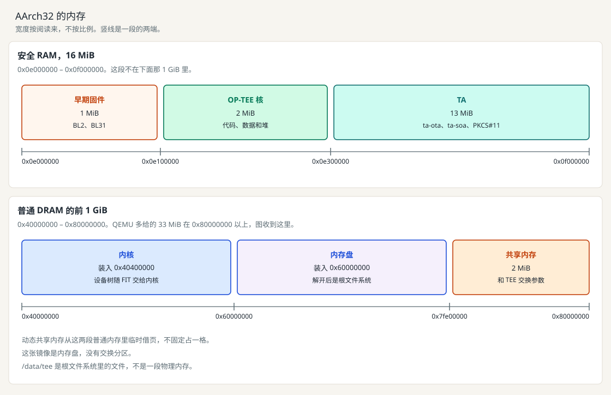

[English](../en/porting.md) | 中文

# 移植到自己的板子

CA、TA 和 `protocol/` 不要按芯片复制。复制 `scripts/aarch64/platform.env`，改 `CROSS_COMPILE` 和 `OPTEE_PLATFORM`。32 位的文件是 `scripts/aarch32/platform.env`。`prepare_env.sh` 把这份文件复制成 `dep-src/env-aarch64.sh` 或 `dep-src/env-aarch32.sh`。`build_qemu.sh` 和 `run_linux.sh` 仍用脚本里自己的机器参数。`versions.env` 仍是整份仓库共用的上游 tag。

1. 确认是带 TrustZone 的 Cortex-A。Cortex-M 和 TriCore 跑不了 OP-TEE，只能复用报文和 PKCS#11 那一侧。
2. 填写 UART、时钟、GIC、核数、安全 DRAM 基址和大小，以及设备树里的 `reserved-memory` 和 `optee` 节点。当前这张 QEMU 镜像不读这些值。
3. 增加 `scripts/build_<板名>.sh`。只改 `CROSS_COMPILE` 和 OP-TEE 的 `PLATFORM`，编译步骤与 `scripts/aarch64/build.sh` 相同。不要在这个脚本里自动下载源码。
4. KVN 和 min SVN 留在 TA 的持久对象里。本仓库不做 RPMB。
5. 板上的令牌替换 OP-TEE 的 PKCS#11 TA。TA 的调用不变。步骤在 [switch-pkcs11.md](../en/switch-pkcs11.md)。
6. 工厂态用 `boot/provision_boot_key.sh --pubkey rot_key.pub.pem` 烧写启动公钥哈希。`burned=1` 后拒绝再写。要模拟一颗新芯片，把 `burned` 手工改回 `0`。QEMU 上的步骤见 [trusted-board-boot.md](../en/trusted-board-boot.md)。
7. 验收仍是启动校验、分块下载、KVN/SVN 和感知与规控通信，命令号不变。

当前这张 32 位 QEMU 镜像的内存如下。宽度按阅读来，不按比例。

`versions.env` 里的 tag 是 clone 目标。换板不改这些 tag，除非板级补丁要求另一版 OP-TEE。

`scripts/prepare_sources.sh` 为两个架构准备同一份 `dep-src/`。提交号已经一致时跳过下载。两个架构各自写入 `dep-src/out/` 下自己的目录。
