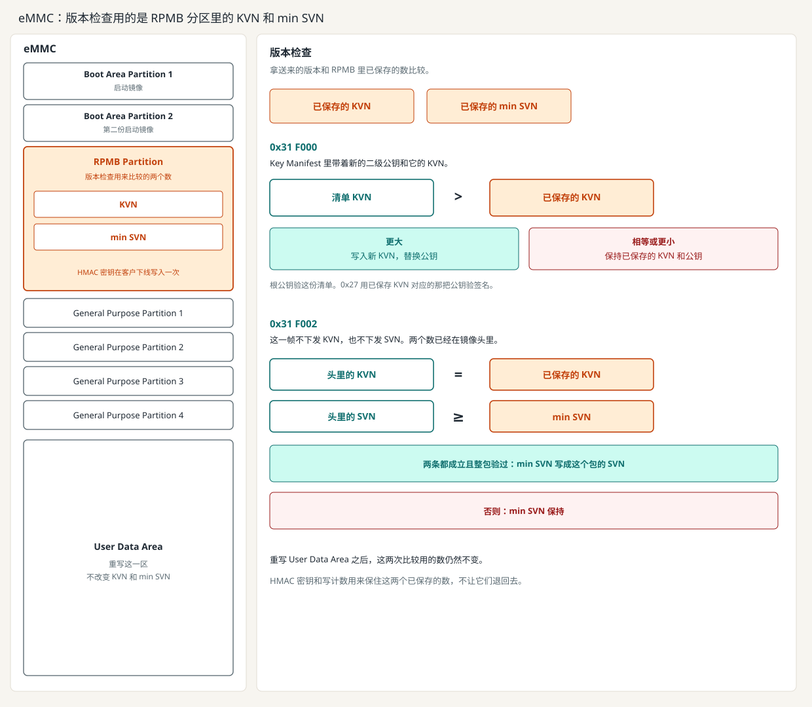
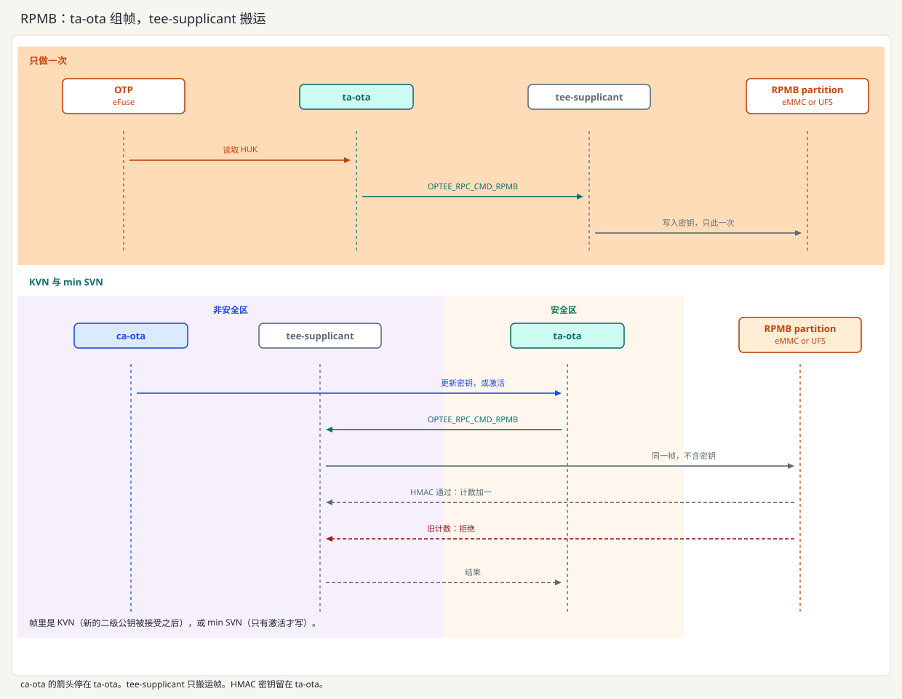

[English](../en/rpmb.md) | 中文

# RPMB、KVN 和 min SVN

## KVN 和 min SVN

KVN，Key Version Number，是当前二级公钥的版本。换上的公钥必须更大，旧公钥不能再回来。

SVN，Security Version Number，是镜像自己的安全版本。min SVN 是还允许激活的最低版本。

| 值 | 何时改变 | 失败或掉电在写入之前 |
| --- | --- | --- |
| KVN | 根公钥验过新的二级公钥，且版本更大 | 保持旧公钥和旧 KVN |
| min SVN | 整包验签通过，激活时写成这个包的 SVN | 保持旧的最低安全版本 |

`0x31 F000` 把新的二级公钥和它的 KVN 放在 Key Manifest 里。`0x31 F002` 不下发这两个数，镜像头里已经有。激活写入 min SVN，要整包验过、头里的 KVN 等于已保存的 KVN、头里的 SVN 不低于 min SVN。`0x27` 用已保存 KVN 对应的公钥。SecOC 的新鲜度留在 TA 里，只在这次上电有效。

图的右边是这次版本检查。左边是这两个数所在的分区。

## RPMB

RPMB，Replay Protected Memory Block，就是这块分区。常见容量 128 KiB 到 4 MiB，访问单位 256 字节。验帧的是这颗闪存。Linux 可以搬帧，改不了里面的值。

颗粒厂发货时，256 位 HMAC 密钥槽是空的。客户下线写入一次。ta-ota 从 HUK 推出这把密钥并写入。设备不把密钥读出来。普通世界如果抢先写入，TEE 以后就用不了这块分区。

之后每次读写都是一帧：地址、数据、设备内部的写计数、HMAC-SHA256。成功写入后设备把计数加一。帧被拒绝、设备接受之前掉电，或重放旧帧，计数和已保存的值都不变。重写 User Data Area 不改变 KVN 和 min SVN。

OP-TEE 在安全世界组帧并计算 MAC。帧以 `OPTEE_RPC_CMD_RPMB` 交给 `tee-supplicant`。它是普通世界里的守护进程，不是 CA，把同一帧交给驱动，再把应答送回。它算不出合法 MAC。只做一次的密钥写入走同样的两跳。这一步没有 ca-ota。之后 ca-ota 调用 ta-ota 更新二级公钥或执行激活，调用停在 ta-ota。

UFS 上，同一套规则用在 RPMB well-known logical unit，JESD220 编号是 `0xC4`。UFS 2.2 和 UFS 3.1 最多四个 RPMB region，各自有自己的密钥和写计数。KVN 和 min SVN 用其中一个。`bBootLunEn` 只选择从哪一个 Boot LUN 启动。`mmc` 打不开这个单元。

eMMC 板上，Buildroot 可以装上 mmc-utils 的 `mmc`（`BR2_PACKAGE_MMC_UTILS=y`）。它从 Linux 发 MMC ioctl，包括读写计数和这一次密钥写入。tee-supplicant 不链接它。

## `/data/tee`，以及两者都没有

**`/data/tee`。** 这是 TEE 对象的加密存储，用来把重启后还要用的数据留下来。这张镜像上，这里放着 `fortress.ota`（KVN、min SVN、公钥字节和根哈希），以及 PKCS#11 令牌自己的存储文件。SecOC 的 AES 密钥是这个令牌里不可导出的对象 `fortress-soa`。`CFG_REE_FS=y` 时才有这个目录。文件密钥由 HUK 推出，Linux 读不出明文。改过的文件，TEE 不接受。它不防回滚。root 可以删掉目录，把整个目录换回更早的一份，校验仍然通过。KVN 和 min SVN 如果只放在这里，删掉目录后 ta-ota 会再次建出厂状态，KVN 1、min SVN 1，服务继续，版本已经回去了。`CFG_REE_FS=n` 时没有这个目录。

**两者都没有。** 板上没有 RPMB 的写计数，也没有 `/data/tee`。设备不记得曾经接受过更高的 KVN 或更高的 min SVN，旧的二级公钥和旧包可以再被接受。密钥若落在普通文件里，可以被读走、改掉，重启之后 TEE 也没有受保护的那一份。在这块板上，OTA 防回滚和受保护的密钥存储都不成立。

这张 QEMU virt 机器没有 eMMC，也没有 UFS，所以 `mmc` 没有设备可开。镜像仍为以后的 eMMC 板子选上 mmc-utils。这张镜像上的 KVN 和 min SVN 在 REE 文件系统。每次启动回到 KVN 1 和 min SVN 1。客户机不检查设备里的写计数。
